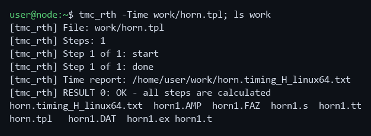
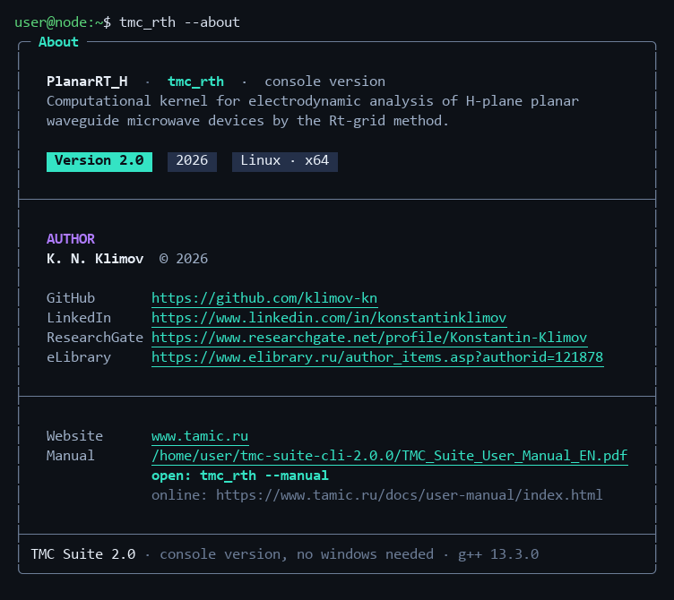
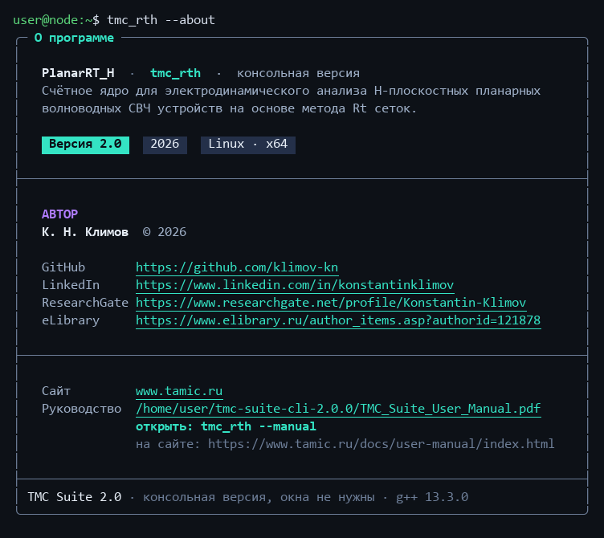

<div align="center">

# TMC Suite 2.0 — computation kernels for Linux

**Scientific software package for electrodynamic simulation of planar structures**

C++ · Linux (x64) · console, no graphics required

**English** · [Русский](#tmc-suite-20--счётные-ядра-для-linux)

</div>

---

## Overview

**TMC Suite** is an authorial scientific software package by **K. N. Klimov** for electrodynamic
computation and visualization of planar structures (H-polarization and X-mode). This repository is
the **Linux port of the computation kernels**: the solvers alone, without windows, for machines
that have nothing but a terminal — a compute server, a cluster node, a container.

The computational code is not rewritten. It is the source tree of the Windows version compiled by
`g++` as is; the MFC layer the kernels were wrapped in is replaced by a thin console entry point.
Results stay compatible with the Windows version: a task calculated here opens in the Windows
viewers, and the other way round.

## What is new in 2.0

- **calculation on a video card** (OpenCL 1.2, double precision): keys `-GPU`, `-GPU:n`, `-CPU`;
- **multi-frequency calculation** and multi-frequency directional patterns;
- **faster preprocessing** of ε distributions (several threads);
- **directional patterns** in batch mode: key `-DN`;
- **calculation time report**: key `-Time`;
- the same messages and **exit codes** as the batch mode of the Windows version;
- an **error at a sweep step** does not break the sweep: the S-matrix of that step is zeros in the
  `.s` file, the next step is calculated, the exit code is 2;
- all fixes of the Windows version: the task parser, the kernels, the `.s` files, the physics model;
- **About** and the **user manual** right from the terminal, in Russian or English;
- **refactored code**: only what is built, no dead code, every file is described;
- the build gives **no compiler errors or warnings**.

## Components

| Program | Purpose |
|---|---|
| `tmc_rth` | solver, H-polarization (PlanarRT_H) |
| `tmc_rtx` | solver, X-mode, incl. magnetized plasma (PlanarRT_X) |

### Libraries
`sfile95` · `complex` · `exprint` · `TMCLibError` · `prepr` · `TMCIndan`

## Running a calculation

```
tmc_rth -Time work/horn.tpl
```



The task is an ordinary `.tpl` file; output files (names from `#OUTPUT` of the task) are written
next to it. `tmc_rtx` runs in the same way. Keep tasks and results on a native Linux disk: the
kernel rewrites its files on every time step.

## Video card

The time-domain calculation can run on a video card through OpenCL 1.2 in double precision:

```
tmc_rth -GPU work/horn.tpl       # the first suitable card
tmc_rth -GPU:1 work/horn.tpl     # the second card
```

| Item | Details |
|---|---|
| Driver | video card driver with OpenCL and double precision (`cl_khr_fp64`) |
| Package | `ocl-icd-libopencl1`; `clinfo` shows whether the system sees the card |
| Numbering | from 0, among the cards with double precision only |
| No card or driver | the calculation runs on the CPU; the `-Time` report gives the reason |
| Small tasks | stay on the CPU, where they are faster; `TMC_GPU_MIN_NODES=0` sends them to the card |
| Results | the same as on the CPU |

## About

```
tmc_rth --about
```



Version, system, author and his pages, website, where the manual is. `tmc_rth --manual` opens the
PDF manual; in a terminal without a desktop it prints the text. `--lang=ru` or `--lang=en` sets the
language of messages.

## Installation

Both builds are published in [Releases](../../releases); nothing has to be installed. Each contains
the kernels and the user manual in Russian and English.

The archive:

```
tar xzf tmc-suite-cli-2.0.0-linux-x86-64.tar.gz
cd tmc-suite-cli-2.0.0
./tmc_rth ~/work/task.tpl
```

The AppImage — the same thing as a single file, handy for a compute node or a container:

```
chmod +x TMC_Suite_CLI-2.0.0-x86_64.AppImage
./TMC_Suite_CLI-2.0.0-x86_64.AppImage tmc_rth ~/work/task.tpl
ln -s TMC_Suite_CLI-2.0.0-x86_64.AppImage tmc_rth && ./tmc_rth ~/work/task.tpl
```

Requirements: x64 and glibc 2.39 or newer — Ubuntu 24.04 LTS and compatible systems. No graphics
libraries are needed. If the system complains about FUSE, add `--appimage-extract-and-run`.

## Command line

```
tmc_rth [keys] <task.tpl>
```

| Key | Meaning |
|---|---|
| `-Time` | write the calculation time report next to the task |
| `-GPU`, `-GPU:n` | calculate on video card `n` (from 0); also `TMC_GPU=n+1` |
| `-CPU` | calculate on the CPU (stronger than `-GPU`) |
| `-DN` | write directional pattern files after the calculation (also `TMC_AUTO_DN=1`) |
| `-q`, `--quiet` / `--verbose` | no progress / every progress line |
| `--about`, `-v` | About |
| `--manual` | open the user manual |
| `--lang=ru\|en` | message language; remembered |
| `-h`, `--help` | help |

## Exit codes

| Code | Meaning |
|---|---|
| 0 | all steps are calculated |
| 1 | error in the task (not found, preprocessor, data) |
| 2 | error during the calculation (the sweep is calculated to the end) |
| 3 | the calculation was stopped (Ctrl+C, `kill`) |

## Documentation

Everything is on the website:

- [console edition](https://www.tamic.ru/docs/platforms/linux-cli.html): keys, environment variables,
  differences from the Windows version;
- [building from source](https://www.tamic.ru/docs/platforms/linux-cli.html#build);
- [installation](https://www.tamic.ru/docs/install/linux.html);
- [user manual](https://www.tamic.ru/docs/user-manual/index.html);
- [code documentation](https://www.tamic.ru/docs/code/index.html).

## Author & links

- **Author of the scientific code:** K. N. Klimov
- **Porting, build and documentation:** M. S. Matsayan
- **Website:** [www.tamic.ru](https://www.tamic.ru)

## License

Apache License 2.0: see [`LICENSE`](LICENSE) and [`NOTICE`](NOTICE).

---
---

<div align="center">

# TMC Suite 2.0 — счётные ядра для Linux

**Научный пакет для электродинамического моделирования планарных структур**

C++ · Linux (x64) · консоль, графика не нужна

[English](#tmc-suite-20--computation-kernels-for-linux) · **Русский**

</div>

---

## О пакете

**TMC Suite** — авторский научный пакет **К. Н. Климова** для электродинамического расчёта и
визуализации планарных структур (H-поляризация и X-мода). В этом репозитории — **перенос счётных
ядер на Linux**: только расчёт, без окон, для машин, где есть лишь терминал: счётного сервера,
узла кластера, контейнера.

Вычислительный код не переписывался. Это исходники версии для Windows, скомпилированные `g++` как
есть; обёртка MFC, в которую были завёрнуты ядра, заменена тонкой консольной точкой входа.
Результаты остаются совместимыми с версией для Windows: задание, посчитанное здесь, открывается в
её просмотрщиках, и наоборот.

## Что нового в 2.0

- **расчёт на видеокарте** (OpenCL 1.2, двойная точность): ключи `-GPU`, `-GPU:n`, `-CPU`;
- **многочастотный расчёт** и многочастотные диаграммы направленности;
- **ускоренный препроцессор** распределений ε (несколько потоков);
- **диаграммы направленности** в пакетном режиме: ключ `-DN`;
- **отчёт о времени расчёта**: ключ `-Time`;
- те же сообщения и **коды завершения**, что у пакетного режима версии для Windows;
- **ошибка на шаге свипа** не обрывает свип: S-матрица этого шага в `.s` нулевая, считается
  следующий шаг, код завершения — 2;
- все исправления версии для Windows: разбор задания, ядра, файлы `.s`, расчётная модель;
- **«О программе»** и **руководство пользователя** прямо из терминала, по-русски или по-английски;
- **код после рефакторинга**: только то, что собирается, без мёртвого кода, каждый файл описан;
- сборка идёт **без ошибок и предупреждений** компилятора.

## Состав

| Программа | Назначение |
|---|---|
| `tmc_rth` | расчёт, H-поляризация (PlanarRT_H) |
| `tmc_rtx` | расчёт, X-мода, в том числе замагниченная плазма (PlanarRT_X) |

### Библиотеки
`sfile95` · `complex` · `exprint` · `TMCLibError` · `prepr` · `TMCIndan`

## Запуск расчёта

```
tmc_rth -Time work/horn.tpl
```


Задание — обычный файл `.tpl`; выходные файлы (имена — из `#OUTPUT` задания) пишутся рядом с ним.
`tmc_rtx` запускается так же. Держите задания и результаты на родном диске Linux: ядро переписывает
свои файлы на каждом такте.

## Видеокарта

Расчёт по времени может идти на видеокарте через OpenCL 1.2 с двойной точностью:

```
tmc_rth -GPU work/horn.tpl       # первая подходящая карта
tmc_rth -GPU:1 work/horn.tpl     # вторая карта
```

| Что | Подробности |
|---|---|
| Драйвер | драйвер видеокарты с OpenCL и двойной точностью (`cl_khr_fp64`) |
| Пакет | `ocl-icd-libopencl1`; `clinfo` показывает, видит ли система карту |
| Нумерация | с 0, только среди карт с двойной точностью |
| Нет карты или драйвера | расчёт идёт на процессоре, причину называет отчёт `-Time` |
| Малые задания | остаются на процессоре: там они быстрее; `TMC_GPU_MIN_NODES=0` отправляет их на карту |
| Результаты | те же, что на процессоре |

## О программе

```
tmc_rth --about
```



Версия, система, автор и его страницы, сайт, где лежит руководство. `tmc_rth --manual` открывает
руководство в PDF, в терминале без графики — выводит текст. `--lang=ru` или `--lang=en` задаёт язык
сообщений.

## Установка

Обе поставки опубликованы в разделе [Releases](../../releases), устанавливать ничего не нужно. В
каждой — ядра и руководство пользователя на русском и английском.

Архив:

```
tar xzf tmc-suite-cli-2.0.0-linux-x86-64.tar.gz
cd tmc-suite-cli-2.0.0
./tmc_rth ~/работа/задание.tpl
```

Образ AppImage — то же самое одним файлом, удобно для счётного узла или контейнера:

```
chmod +x TMC_Suite_CLI-2.0.0-x86_64.AppImage
./TMC_Suite_CLI-2.0.0-x86_64.AppImage tmc_rth ~/работа/задание.tpl
ln -s TMC_Suite_CLI-2.0.0-x86_64.AppImage tmc_rth && ./tmc_rth ~/работа/задание.tpl
```

Требования: x64 и glibc 2.39 или новее — Ubuntu 24.04 LTS и совместимые системы. Графические
библиотеки не нужны. Если система ругается на FUSE, добавьте ключ `--appimage-extract-and-run`.

## Командная строка

```
tmc_rth [ключи] <задание.tpl>
```

| Ключ | Что делает |
|---|---|
| `-Time` | записать рядом с заданием отчёт о времени расчёта |
| `-GPU`, `-GPU:n` | считать на видеокарте `n` (с 0); то же — `TMC_GPU=n+1` |
| `-CPU` | считать на процессоре (сильнее `-GPU`) |
| `-DN` | после расчёта записать диаграммы направленности (то же — `TMC_AUTO_DN=1`) |
| `-q`, `--quiet` / `--verbose` | не выводить ход расчёта / выводить каждую строку |
| `--about`, `-v` | о программе |
| `--manual` | открыть руководство пользователя |
| `--lang=ru\|en` | язык сообщений; запоминается |
| `-h`, `--help` | справка |

## Коды завершения

| Код | Значение |
|---|---|
| 0 | все шаги посчитаны |
| 1 | ошибка задания (нет файла, препроцессор, данные) |
| 2 | ошибка во время расчёта (свип считается до конца) |
| 3 | расчёт остановлен (Ctrl+C, `kill`) |

## Документация

Всё на сайте:

- [консольная версия](https://www.tamic.ru/docs/platforms/linux-cli.html): ключи, переменные
  окружения, отличия от версии для Windows;
- [сборка из исходников](https://www.tamic.ru/docs/platforms/linux-cli.html#build);
- [установка](https://www.tamic.ru/docs/install/linux.html);
- [руководство пользователя](https://www.tamic.ru/docs/user-manual/index.html);
- [документация на код](https://www.tamic.ru/docs/code/index.html).

## Авторы и ссылки

- **Автор научного кода:** К. Н. Климов
- **Портирование, сборка, документация:** М. С. Мацаян
- **Сайт:** [www.tamic.ru](https://www.tamic.ru)

## Лицензия

Apache License 2.0: см. [`LICENSE`](LICENSE) и [`NOTICE`](NOTICE).
